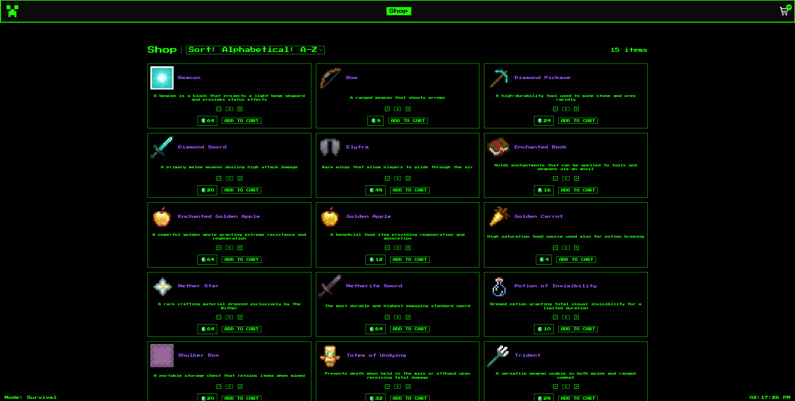

# MineRetro Shop — E-Commerce Cart

A terminal-inspired, Minecraft-themed e-commerce web application built with **React 18** and bundled with **Vite**.



## Live Demo
Check out the live deployment: **[minecraft-shopping-cart.netlify.app](https://minecraft-shopping-cart.netlify.app/)**

---

## Technical Highlights & Architecture

* **Extensive Automated Testing Suite (43 Tests Passed):**
  * 15 distinct test suites covering full application behavior using **Vitest** and **React Testing Library**.
  * Validates component mounting, navigation triggers, input sanitization, boundaries/clamping on numeric inputs, sort mechanics, subtotal calculations, and item removals.
* **Centralized State & Persistence (`ShopContext`):**
  * Custom context provider managing global shopping cart state across decoupled routes.
  * Synchronized with `localStorage` so user selections and cart quantities persist across page reloads and browser sessions.
  * Real-time calculation of badge counters and cart aggregates without redundant re-renders.
* **Resilient Data Fallback Architecture:**
  * Implemented an internal static data catalog with binary search lookup utilities (`binarySearchItem`), ensuring the storefront remains 100% operational and immune to third-party public API outages.
* **Client-Side Routing & SPA Configuration:**
  * Multi-view navigation (`Home`, `Shop`, `Checkout`) powered by **React Router v6**.
  * Configured with server rewrites (`_redirects`) for seamless deep-link resolution on Netlify.
* **Modular CRT & Pixel-Art Aesthetics:**
  * Scoped styling using **SCSS Modules** preventing class name collisions.
  * Enforced crisp pixel rendering (`image-rendering: pixelated;`) for authentic 16x16 Minecraft item textures alongside custom CRT terminal glow typography.
* **Code Quality & CI Enforcements:**
  * Formatted with **Prettier** and strictly linted with **ESLint** (including React Hooks rules).
  * Automated pre-commit validation using **Husky** to prevent broken code or failing style rules from entering source control.

---

## Features

- **Retro Terminal Interface:** Monochromatic green-on-black terminal design with responsive layout support.
- **Dynamic Catalog & Sorting:** Instant client-side ordering (Alphabetical A-Z, Z-A, and Price High/Low).
- **Interactive Cart Controls:** Increment, decrement, and direct numerical quantity editing with input clamping.
- **Live Cart Badge:** Header indicator dynamically updates in real time to reflect cumulative item counts.
- **Item Removal & Subtotals:** Granular item removal and instant price calculations on the checkout screen.

---

## Tech Stack

* **Frontend Framework:** React 18
* **Build Tool:** Vite
* **Routing:** React Router v6
* **State Management:** React Context API + LocalStorage persistence
* **Testing:** Vitest, React Testing Library, jsdom
* **Styling:** SCSS Modules, CSS3 (Pixelated image rendering, custom scrollbars)
* **Code Quality:** ESLint, Prettier, Husky (pre-commit hooks)
* **Hosting:** Netlify

---

## Getting Started

### Prerequisites
* Node.js (v18 or higher recommended)
* npm

### Installation & Local Development

1. **Clone the repository:**
   ```bash
   git clone https://github.com/sadwipe/shopping-cart.git
   cd shopping-cart
   ```

2. **Install project dependencies:**
   ```bash
   npm install
   ```

3. **Start the development server:**
   ```bash
   npm run dev
   ```
   Open your browser and navigate to `http://localhost:5173`.

### Running Tests

Execute the complete Vitest test suite:
```bash
npm test
```

### Production Build

Create an optimized production bundle:
```bash
npm run build
```

Preview the production build locally:
```bash
npm run preview
```
